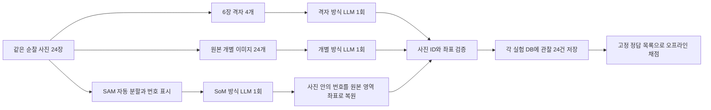

# 순찰 사진: 문헌 사례 3종의 실제 LLM 비교

동일한 Gazebo 순찰 원본 24장에 세 가지 입력 기법을 적용했다. 실제 OpenAI
Responses API로 방식당 1회 호출하고 기존 순찰 메모리 워커를 통해 사진별 관찰
24건을 각각의 SQLite DB에 저장했다. 운영 기본값은 기존 구분 강화 모음 이미지다.
실험용 스크립트는 로봇 설정이나 주행을 변경하지 않는다.

## 사례의 기법과 이번 적용

| 사례 | 원래 핵심 기법 | 이번 구현 | 원래 사례와 차이 |
|---|---|---|---|
| [IG-VLM](https://arxiv.org/html/2403.18406v1) | 영상 구간에서 대표 6장 선택, 3열×2행 격자, 읽는 순서 안내 | 연속 6장씩 격자 4개를 한 요청에 입력. F번호, 테두리, 칸 범위 제공 | 원본 24장을 모두 보존. 프레임 선택/VQA 대신 사진별 관찰 JSON. 다른 모델 사용 |
| [Set-of-Mark](https://github.com/microsoft/SoM) | 분할·검출 모델이 영역 제안, 번호/문자와 마스크·상자로 대상 참조 | SAM ViT-B 자동 분할 → 마스크 필터 → 윤곽·번호 → LLM이 사진별 mark_id 선택 → 서버가 원본 bbox 복원 | SAM 구성과 마스크 수 제한, 모델·출력 목적이 다른 응용 실험. 논문의 정식 재현은 아님 |
| [OpenAI 영상 이해 예제](https://developers.openai.com/cookbook/examples/gpt_with_vision_for_video_understanding) | 영상 프레임 추출·간격 샘플링, 여러 개별 input_image를 한 요청에 제공 | 원본 24장 모두를 F번호 메타데이터와 번갈아 입력. 사진 자체 좌표로 bbox 반환 | 샘플링 생략. 보관된 예제 모델 대신 비교 모델 통일 |

SoM은 사진 카드에 번호만 붙인 이전 개선과 다르다. 로컬 SAM이 실제 사진의
영역을 분할하며, LLM은 그 영역 번호를 참조한다. 마스크는 물체 정답이나 분류
라벨이 아니다. 벽·바닥·물체 일부·겹치는 영역도 제안된다.



## 실험 조건

- 원본 JPEG 해시 24개 및 순서가 이전 두 실험과 동일하다. 새 주행은 없다.
- 모델 `gpt-5.6-luna`, `detail=high`, 출력 상한 12,000토큰,
  사진별 주요 물체 최대 8개, 방식당 호출 1회. 추가 재시도·좋은 응답 선택 없음.
- 6장 격자는 1528×864px 이미지 4개, 각 원본 표시 480×300px.
  개별 입력과 SoM 입력은 각각 640×400px 이미지 24개다.
  기존 24장 격자의 실제 사진 표시는 320×200px다.
- 공통 관찰 지시문에 방식별 좌표·영역 참조 설명만 더했다. 기존 두 실험과는
  메타데이터 형식·프롬프트도 일부 달라 단일 변수 효과로 해석할 수 없다.
- 평가 목록을 생성·분할·LLM 입력에 넣지 않았다. 이전과 같은 6종 물체의
  선정 등장 35건, 이름 매칭 규칙, 별도 확인한 부재 11항목을 사용한다.
  이는 전체 물체 정밀도·재현율이나 독립 인력의 벤치마크가 아니다.
- 기존 키를 메모리에서 재사용했다. 키·이미지·모델 가중치·응답 원문은 Git에 넣지 않는다.

## 실제 결과

| 방식 | 명칭 인식 | 고정 오기록 재발 | 좌표 없음 / 전체 물체 | 입력 / 출력 | 비용 USD | 원화 가정 |
|---|---:|---:|---:|---:|---:|---:|
| 기존 24장 격자 | 18/35 (51.4%) | 11/11 | 52/112 | 5,178 / 4,981 | $0.00727155 | 10.91원 |
| 구분 강화 24장 격자 | 20/35 (57.1%) | 1/11 | 0/91 | 6,556 / 4,067 | $0.00651925 | 9.78원 |
| IG-VLM 응용: 6장 격자 × 4 | 25/35 (71.4%) | 0/11 | 68/111 | 9,691 / 4,840 | $0.00823060 | 12.35원 |
| 개별 이미지 24개 | 27/35 (77.1%) | 0/11 | 0/115 | 10,527 / 4,803 | $0.00839520 | 12.59원 |
| SoM 응용: SAM 번호 24장 | 5/35 (14.3%) | 0/11 | 0/100 | 13,026 / 4,210 | $0.00830835 | 12.46원 |

이전 기존 격자의 대략적 휴지통 표현 2건까지 인정하면 20/35다. 다른 방식에는
고정된 대략적 표현 규칙에 해당하는 추가 점수가 없다. 이름 점수와 좌표 정확도는 별개다.

| 종류 | 선정 등장 | 기존 | 구분 강화 | 6장 격자 | 개별 24장 | SoM |
|---|---:|---:|---:|---:|---:|---:|
| 파란 운동 공 | 10 | 9 | 9 | 10 | 10 | 0 |
| 바벨·원판 | 8 | 1 | 1 | 1 | 7 | 0 |
| 하늘색 휴지통 | 7 | 1 | 3 | 7 | 3 | 0 |
| 냉장고 | 6 | 3 | 3 | 3 | 3 | 3 |
| 침대 | 2 | 2 | 2 | 2 | 2 | 2 |
| 벽걸이 에어컨 | 2 | 2 | 2 | 2 | 2 | 0 |

### 결과 해석

- **개별 24장 입력**이 이번 조건에서 가장 유리했다. 선정 이름 27/35, 입력 24개지만
  호출은 1회다. 구분 강화 대비 약 2.81원 증가, 명칭 점수는 20%p 증가했다.
  작은 휴지통·가려진 냉장고는 여전히 놓치며 bbox 정답률은 측정하지 않았다.
- **6장 격자 4개**는 휴지통 7/7을 찾았지만, 여러 격자의 사진 칸을 혼동한
  좌표가 많았다. 68/111 bbox가 지정된 사진 밖에 있어 서버가 null로 보존했다.
  명칭 점수 25/35만 보고 위치 기억에 적합하다고 판단하면 안 된다.
- **SAM + SoM**은 이번 구현에서 5/35로 크게 떨어졌다. 공을 ‘둥근 물체’로
  기록하고 바벨·휴지통·에어컨을 놓쳤다. 100개 선택 번호는 모두 해당 사진에
  존재했으나, 예를 들어 F15에서는 바닥 영역을 냉장고로 설명했다. 번호 검증은
  의미 검증을 대신하지 못한다. 고정된 부재 11항목에서 0건이어도 다른 오류가 많다.
  숫자 가림·중첩·부분 마스크가 관찰됐지만 점수 저하의 인과 원인은 분리 검증하지 않았다.
  이 결과를 SoM 연구 전반의 성능으로 일반화하지 않는다.

API 응답 시간은 6장 격자 35.4초, 개별 입력 41.0초,
SoM 31.6초였다. SoM은 별도로 CPU 전처리 527.7초
(약 8.8분), 총 763개 후보 영역이 필요했다. 모델 다운로드·초기 로딩 시간은 제외다.

이번 새 유료 요청은 총 3회, 합계 $0.02493415
(약 37.40원)이다. 세 방식 모두 관찰 24건 저장, DB 무결성 및 재호출 방지까지 확인했다.
서버 기본 입력 방식 변경은 이번 실험에 포함하지 않았다.

## SAM 전처리

[공식 Segment Anything](https://github.com/facebookresearch/segment-anything)의
ViT-B 체크포인트를 사용했다. CPU 4스레드, 이미지별 16×16 점,
점 배치 32, 예측 IoU 임계 .86, 안정성 .92, 추가 crop 없음이다.
120px 미만 또는 사진의 75% 초과 영역을 제외하고, 마스크 IoU .85 초과 중복을
제거한 뒤 면적순 최대 40개를 보존한다. 물체 종류에 따른 선택은 하지 않는다.

원본 색을 보존하며 1px 윤곽과 숫자 배지를 그렸다. 마스크의 중심에 가까운
내부 픽셀에 배지를 놓는다. `mark_id`는 사진 내부에서만 유효하고, 다른 사진의
같은 번호를 빌려오지 않는다. 없는 번호나 null은 좌표 없음으로 남긴다.
원본 이진 마스크, bbox, 분할 품질 점수, 입력 해시 및 처리 시간을 로컬에 보존했다.

## 비용 계산

[공식 단가](https://developers.openai.com/api/docs/pricing)와 실제 응답 usage를 사용한다.
GPT-5.6의 기본 30분 캐시 쓰기는 일반 입력의 1.25배이며, 일반 입력과 중복
합산하지 않는다. [공식 캐시 회계 설명](https://developers.openai.com/api/docs/guides/prompt-caching#monitor-cache-performance).

```text
일반 입력 = input_tokens - cached_tokens - cache_write_tokens
USD = (일반 입력×0.20 + 캐시 읽기×0.02 + 30분 쓰기×0.25
       + 12시간 쓰기×0.50 + 출력×1.20) / 1,000,000
```

이번 요청은 기본 30분 캐시를 사용한다. 원화는 $1=1,500원 가정이며 세금,
후속 질문, 로컬 SAM 컴퓨팅 비용을 제외한다. 이전 보고서의 캐시 쓰기 누락을
정정해 모든 방식에 같은 계산을 적용했다. 청구서가 아닌 usage 기반 추산이다.
앞으로 운영 관찰의 `patrol_analysis_batches.usage`에도 캐시 쓰기 총량과 응답이
제공하는 수명별 쓰기 토큰을 보존한다. 응답에 없는 수치를 추정해 채우지는 않는다.

## 재현 도구와 보존 자료

- `scripts/patrol_method_comparison.py`: 입력 준비, 단일 실제 요청, 응답 검증,
  기존 워커/DB를 통한 저장. `prepare`와 `run`을 분리한다.
  실행은 기존 `OPENAI_API_KEY`를 읽으며 키를 파일로 쓰지 않는다.
  요청 시작 파일을 배타적으로 생성해 실패 후 무심코 유료 재실행하지 못하게 한다.
- `scripts/patrol_sam_marks.py`: 정답과 무관한 SAM 자동 분할 및 번호 표시.
- `scripts/report_patrol_methods.py`: 응답 이후 고정 기준 채점, 비용 계산,
  사진별 양쪽 결과·bbox·SAM 입력을 고를 수 있는 HTML 보고서 생성.
- 각 방법 폴더의 `plan.json`, `prompt.txt`, `inputs`, `response.json`,
  `observations.json`, `verification.json`, `memory/observations.sqlite3`에
  요청 근거·실제 응답·사용량·저장 결과를 보존한다.
- 정답 목록 SHA256 및 원본 24개 해시를 `comparison.json`에 기록한다.
  HTML/JSON 보고서는 저장된 응답만 읽어 재생성하며 API를 호출하지 않는다.

## 검증 범위와 한계

사진 ID의 누락·중복·변조 거부, 다른 사진의 영역 번호 차용 방지,
격자 칸 밖 bbox 제거, 캐시 읽기/쓰기 분리 비용 계산을 오프라인 테스트한다.
실제 실행에서는 각 DB에 24건 `ready`, 무결성 `ok`, 완료 후 워커 재호출 시
추가 API 요청 없음까지 확인한다.

`ready`는 처리 완료 상태다. 이름을 맞혀도 bbox나 SAM 영역 선택이 틀릴 수 있으며,
유효한 좌표가 정답을 보장하지 않는다. 원본에는 깊이·지도 구역 라벨이 없으므로
모든 물체 구역은 `unknown`이다. 실제 구역 분류·이동 추적·후속 질문 응답 정확도는
이번 입력 기법 비교의 측정 대상이 아니다. 모든 결과는 방식당 1회의 개발 실험이다.
