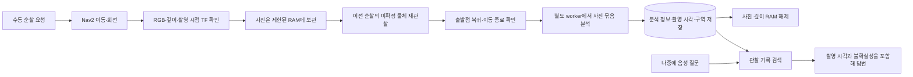
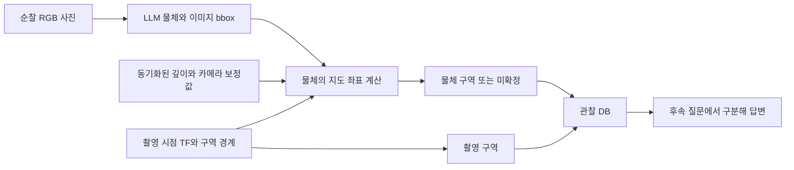

# Malbut Camera Patrol

저장된 지도에서 관측 위치를 자동으로 선택하여 접근 가능한 공간을
카메라로 살피는 단일 ROS Action입니다. 고정 순찰 좌표나 예약 주기는 없습니다.

수동 순찰은 기본적으로 서로 다른 카메라 시점의 사진을 기록합니다. 사진은
로컬에 저장하고, 순찰 종료 후 Agent 음성 서버가 기존 OpenAI 키로 묶어서 분석합니다.
이후 “아까 순찰 때 뭐 봤어?”, “리모컨 어디서 봤어?”처럼 물어볼 수 있습니다.
촬영·분석·조회 설정은 아래 **사진 관찰 기억**을 참고하세요.

## 공개 계약

- Action: `/patrol`, `malbut_interfaces/action/Patrol`
- Goal: `thoroughness` — `LIGHT=0`, `NORMAL=1`(기본), `THOROUGH=2`
- Feedback: `state`, `coverage_ratio`(0..1), `viewpoints_visited`
- Result: `success`, `message`, `coverage_ratio`, `viewpoints_visited`
- 모니터링 Topic: `/patrol/status`, `std_msgs/msg/String` JSON
  (`state`, `detail`, `coverage_ratio`, `viewpoints_visited`, `unvisited_rooms`,
  `inaccessible_rooms`, `room_count`: 이 순찰이 쓴 방 수, 방 파일이 없으면 0)
- 중앙 Manifest: `malbut_interfaces/capabilities/patrol.yaml`

한 요청은 한 번의 순찰입니다. 원하는 관측률과 접근 가능한 각 방의 방문·관측을
달성하면 성공합니다. 후보가 모두 막히거나 충분한 관측을 얻지 못하면 부분
관측률과 사유를 담아 실패로 종료합니다. 실패한 같은 후보를 무한 재시도하지
않습니다. 취소는 진행 중인 Nav2 Action의 종료 확인 후 완료합니다. 취소 확인이
늦어지면 경고와 `stopping` 상태를 유지하며, 해당 Nav2 목표가 실제 종료될 때까지
결과를 반환하거나 새 요청을 받지 않습니다. 중복 요청은 거부하며 선점 판단은
시스템 관리자가 담당합니다.

## 어떻게 위치를 고르는가

1. `/map`의 점유 격자에서 장애물 여유 거리와 로봇에서 연결된 안전 영역을
   한 번 계산합니다. 알 수 없는 영역과 벽은 통과하지 않습니다.
2. 안전 영역을 일정 간격으로 나누어 관측 후보를 만듭니다. 방 라벨이 있으면
   각 방에도 후보가 포함되게 합니다. 후보의 좌표는 모두 지도에서 계산합니다.
3. 각 후보에서 볼 수 있는 영역을 벽·미확인 영역의 가림과 거리로 계산해
   메모리에 보관합니다.
4. 방문하지 않은 방, 관측이 부족한 방, 새롭게 볼 수 있는 면적과 이동 거리를
   고려해 다음 후보를 고릅니다. 현재 Global Costmap에서 위험한 목표는 제외합니다.
5. Nav2 `NavigateToPose`로 이동하고 `Spin`으로 주변을 살핍니다. 이동·회전 중에도
   실제 RGB 프레임의 시각, CameraInfo의 수평 시야각, TF의 카메라 방향으로
   관측 영역을 갱신합니다. 새 목표를 보냈다는 이유로 관측률을 늘리지 않습니다.
6. 이미 본 면적을 제외하고 다음 후보를 선택합니다.

Nav2가 실제 경로·충돌 회피·회전을 담당합니다. 이 패키지는 속도 명령을
직접 발행하거나 Nav2 컨트롤러 설정을 바꾸지 않습니다.

## 막힌 경로에서 되돌아가기

이동 실패·정체 또는 관측 후보 소진 시, 최근 실제 이동 기록에서 최대 1.5m
거리의 이전 위치를 골라 복구를 시도합니다. `PatrolRecovery` Hybrid A*의
Reeds–Shepp 경로는 차체 방향을 유지한 후진과 전진·후진을 섞은 곡선 이동을
허용합니다. 순찰 전용 BT는 일반 Spin/BackUp 복구 대신 실패를 순찰 관리자에
돌려주며, 기존 이동 Action 종료와 정지를 확인한 후 복구를 시작합니다.

- 최근 60초, 최대 256개 위치를 보관합니다. 위치 정보가 1초 이상 끊기거나
  map→odom이 기준보다 12cm/0.15rad 이상 바뀌면 기록을 폐기합니다.
- 순찰당 최대 2회, 회당 최대 3개 이전 위치를 검토합니다. 경로는 기록 주변
  35cm 안, 총 3m 이하, 방향 전환 4회 이하이며 전체 복구 시간은 90초입니다.
- 전용 RPP 컨트롤러는 최대 0.08m/s로 움직이고 방향 전환 사이에 정지를
  확인합니다. 실제 장애물 지도와 차체 footprint 충돌 검사를 계속 사용합니다.
- Hybrid 탐색이 실패하면 실제 이동 기록을 후보로 사용합니다. 현재 지도에서
  막혔거나 알 수 없는 중심 경로를 먼저 거부하고, 주행 중 전체 차체와 진행 방향의
  충돌은 RPP가 검사합니다. 예전에 통과했어도 새 장애물을 무시하지 않습니다.
- 복구 중 위치 추정 변화, 오래된 TF·라이다·비용 지도, 취소 또는 충돌 위험은
  복구를 중단합니다. 실패한 구간 뒤의 전진·후진을 이어서 실행하지 않습니다.
- 복구 후 원래 목표를 한 번 다시 시도합니다. 닫힌 문이 열렸다고 간주하거나
  순찰 전체 경로를 무제한 후진으로 바꾸지는 않습니다.

`/patrol/status`의 `recovery`에 시도 횟수, 상태, 경로 출처와 방향 전환 횟수를
표시합니다. `recovery_enabled:=false`로 기존 Nav2 기본 BT를 사용할 수 있습니다.
기본 bringup의 `PatrolRecovery` planner/controller 설정이 필요합니다.

## 꼼꼼함 기본값

| Goal | 관측 인정 거리 | 목표 관측률 | 후보 간격 |
|---|---:|---:|---:|
| LIGHT (0) | 4m | 80% | 1.5m |
| NORMAL (1) | 3m | 90% | 1.0m |
| THOROUGH (2) | 2m | 95% | 0.65m |

이는 초기 운용값이며 실측한 카메라 식별 성능을 뜻하지 않습니다. 강도가 높으면
가까이서 봐야 관측으로 인정하므로 더 많은 곳을 방문합니다. 전체 면적뿐 아니라
접근 가능한 각 방에도 목표 관측률을 적용합니다. 갈 수 없는 방은 완료 조건에서
제외하고 상태 정보로 구분합니다.

관측률은 **수평 시야를 평면 지도에 투영한 면적의 비율**입니다. 관측률 자체는 실제 영상
내용을 분석하거나 바닥·가구·벽의 모든 3D 표면이 보였는지 검사하는 지표가
아닙니다. 현재 LOS 가림은 저장 지도 기준이므로 움직이는 사람이나 높이가 다른
가구에 의한 추가 가림까지 완벽히 검증하지 않습니다. 분모는 안전한 후보에서
관측 가능한 알려진 자유 공간입니다.

## 실행

Nav2 Map Server에 현재 사용할 저장 지도를 로드하고, 위치 추정·카메라·Nav2를
먼저 실행합니다. `/map`을 사용하므로 패키지 안에 특정 지도 파일을 넣지 않습니다.
기존 Small House Nav2도 같은 입력을 제공합니다.

```bash
cd ~/ros2_ws
source /opt/ros/humble/setup.bash
colcon build --symlink-install --packages-select malbut_interfaces malbut_patrol
source install/local_setup.bash
ros2 launch malbut_patrol patrol.launch.py use_sim_time:=true \
  camera_optical_frame:=camera_depth_optical_frame
```

위 광학 프레임 지정은 Fortress RGB-D의 `camera_link` 헤더를 위한 것입니다.
실제 로봇은 `use_sim_time:=false`로 실행하고 표준 광학 프레임 헤더를 제공하면
`camera_optical_frame`을 비워둡니다. 방 라벨은 선택 사항이며
`room_map_file:=/absolute/path/to/user-map.geojson`으로 지정합니다. 좌표가 현재
`/map`과 일치하는 `role: room` Polygon/MultiPolygon을 사용합니다. 방 대표점을
고정 순찰 좌표로 사용하지 않습니다. 라벨이 없어도 전체 영역을 순찰합니다.

직접 실행:

```bash
ros2 action send_goal /patrol malbut_interfaces/action/Patrol \
  '{thoroughness: 1}' --feedback
```

시스템 관리자 경유 (`system_manager.launch.py`도 실행되어 있어야 함):

```bash
ros2 action send_goal /malbut/mission/execute \
  malbut_interfaces/action/ExecuteMission \
  "{capability_id: patrol, arguments_yaml: '{thoroughness: 1}'}" --feedback
```

새 Manifest는 `malbut_interfaces` 설치 폴더에 자동 포함됩니다. 이미 실행 중인
시스템 관리자는 재시작하여 목록을 다시 읽어야 합니다. 기능별 wrapper Action을
추가하거나 관리자 코드에 순찰 전용 분기를 넣지 않습니다.

기존 웹 순찰 시작·중지 API도 이 Action을 사용합니다. 예전 pause는 취소하여
IDLE로 돌아가고 resume은 새 순찰을 시작합니다. 순찰 이력을 보존하는 일시정지는
이번 Action 계약에 없습니다. 예전 `/patrol/start`, `/patrol/stop` 등의 Trigger와
`route_file` 기반 경로·예약 설정은 제거했습니다.

## 설정

ROS parameter로 환경과 운용값을 지정합니다.

| 파라미터 | 기본값 / 의미 |
|---|---|
| `map_topic` | `/map`, 저장된 `nav_msgs/OccupancyGrid` |
| `costmap_topic` | `/global_costmap/costmap`, 목표 안전성 확인 |
| `camera_image_topic` | `/camera/color/image_raw`, 실제 RGB 프레임 |
| `camera_info_topic` | `/camera/color/camera_info`, 광학 프레임·보정값 |
| `camera_optical_frame` | 빈 값: 영상 헤더 사용. Fortress는 `camera_depth_optical_frame` |
| `base_frame` | `base_footprint` |
| `room_map_file` | 빈 값, 선택적 방 라벨 GeoJSON |
| `nav2_action_name`, `spin_action_name` | `navigate_to_pose`, `spin` |
| `recovery_enabled`, `odom_frame` | `true`, `odom`: 최근 이동 기록을 이용한 제한 복구 |
| `navigation_behavior_tree` | 설치된 `config/patrol_navigation.xml`, 순찰 이동 전용 BT |
| `robot_clearance_m` | 0.26m, 후보 위치의 차체 외접 반경·여유 |
| `observation_ranges_m` | `[4.0, 3.0, 2.0]` |
| `coverage_targets` | `[0.80, 0.90, 0.95]` |
| `candidate_spacing_m` | `[1.5, 1.0, 0.65]` |
| `observation_hz` | 5Hz, 최신 프레임을 관측에 반영하는 최대 빈도 |
| `sensor_timeout_s`, `costmap_timeout_s` | 3s, 5s, 입력 단절 검출 |
| `navigation_timeout_s` | 120s, 한 후보에 묶이지 않도록 이동 취소 후 다른 후보 시도 |
| `stall_timeout_s`, `stall_distance_m` | 30s, 0.10m. Nav2가 재시도하는 동안 로봇이 이만큼 움직이지 않으면 이동 취소 후 다른 후보 시도 |
| `spin_time_allowance_s` | 60s, 한 바퀴 회전의 Nav2 실행 허용 시간 |
| `goal_response_timeout_s`, `cancel_completion_timeout_s` | 각각 5s, 통신 응답·종료 확인 |
| `maximum_goal_cost` | 80, OccupancyGrid 표현의 목표 허용 비용 |

실제 회전 속도는 기존 Nav2 Spin 설정을 따릅니다. 관측 계산은 요청 실행 중에만
수행하며, 대기 상태에서는 구독 메시지의 최신 값만 보관합니다. 새 저장 지도가
실행 도중 들어오면 남은 주행을 취소하고 새 지도에서 다시 요청하도록 알립니다.
Nav2가 전체 격자 대신 부분 갱신을 발행할 때는 `costmap_topic`에 `_updates`를
붙인 Topic의 `map_msgs/OccupancyGridUpdate`도 반영합니다.

## 사진 관찰 기억



- 일반 순찰은 **이동·촬영·출발점 복귀를 먼저 완료**합니다. 현재 사진의 분석 결과를
  기다리느라 순찰 중 정지하지 않습니다. 촬영을 위한 정지·방향 맞춤과 Nav2의
  장애물 대기는 유지합니다. 순찰 성공과 기억 분석·저장 완료는 별개입니다.
- 이전 순찰에서 미확정인 물체는 다음 순찰 시작 시 한 번 조회합니다. 최근 24시간의
  동일 소유자·지도·좌표계·구역 경계·실제/시뮬 환경에서 저장 증빙이 검증된 기록만
  사용하며, 한 순찰 최대 2개·대상 계보별 최대 2회로 제한합니다. 과거 사람 위치는
  추적 목표로 사용하지 않습니다. 좌표는 다시 볼 방향의 힌트이며 같은 물체라는 뜻은 아닙니다.
- 첫 유효 시점과 이후 `OBSERVING`의 새로운 방향을 촬영합니다. 기본 최대 24장,
  재관찰 최대 2장은 별도 묶음입니다. 최소 간격 1.5초이며, 0.6m 안에서 방향 차이가
  60도보다 작은 시점은 중복으로 생략합니다. 이동 중 추가 촬영은 하지 않습니다.
- 긴 변 최대 1280px JPEG와 깊이·라이다·구역 자료는 파일로 남기지 않습니다.
  인코딩 큐는 4개, 원본 전달용 RAM은 최대 128MiB, 각 자료의 유효 기간은
  인코딩 시점부터 900초입니다. 복귀했다고 유효 기간을 연장하지 않습니다.
  만료·용량 초과·재시작으로 원본을 잃으면 분석 실패로 남기며 위치를 만들어내지 않습니다.
- 기본 폴더 `~/.local/share/malbut/patrol-observations`의 `captures/`에는 촬영
  메타데이터 JSON만, `observations.sqlite3`에는 분석 정보·처리 상태·저장 증빙을
  남깁니다. 정상 분석 후에는 원본 RAM을 해제합니다. 사진을 버린 후에도 증빙이
  유효한 분석 결과는 촬영 시각과 함께 조회할 수 있습니다.
- `/patrol/status`의 `photos`에는 `queued`, `saved`(RAM 준비), `failed`,
  `discarded`, `batch_ready`, `analysis_held`, `analysis_pending_batches`가 있습니다.
  `batch_ready`는 분석 요청 공개 여부이며, DB의 `ready`와 다릅니다.
- 취소·부분 실패 시에도 Nav2 정지가 확인된 사진은 분석할 수 있습니다. 정지를
  확인하지 못하면 보류 사진을 폐기하고 새 순찰을 막습니다. 재시작 시 RAM은 복구되지 않습니다.
- 분석 worker는 기존 음성 Agent와 기존 API 키를 사용합니다. 새 키를 만들지 않으며,
  분석·네트워크 요청 중에는 DB 쓰기 트랜잭션을 유지하지 않습니다. 순찰 결과를 먼저
  반환하고 분석·저장은 별도로 진행합니다. 앞선 순찰의 이미 시작된 분석을 취소하는 기능이나
  SAM의 CPU 점유율 제한은 이 경로에 포함되지 않습니다.
- 시연 범위는 일반 순찰·복귀 후 VLM 분석, 기존 깊이·TF 기반 구역 판정,
  분석 정보 저장과 원본 RAM 해제까지입니다. SAM 표면 분리·구역 보정은
  메모리 사용량과 처리 지연을 고려해 시연에서 제외하고 후속 고도화로 둡니다.
  기본 방식으로 판단할 수 없는 구역은 미확정으로 저장합니다.
- 후속 고도화 항목: 미확정 대상에만 경량 SAM을 적용하되, 다른 기능과 함께
  실행하는 실제 로봇에서 메모리 상한·처리 시간·구역 오판률을 검증한 뒤 도입합니다.
- `inspection_calibration_file`을 지정한 별도 검사 모드는 분석 증빙으로 관측 면적을
  인정해야 하므로 기존의 분석 대기·같은 순찰 안의 재관찰을 유지합니다.

로컬 통합 시험에서는 별도 폴더에 `PatrolMemoryStore(directory, owner_id,
simulation=True)`를 명시해 가상 사진의 분석·재조회 경로를 검증할 수 있습니다.
DB에 환경 구분이 고정되어 실제 관찰 DB와 바꾸어 열 수 없으며, 검색 결과에도
`environment`, `simulated`, `analysis_model`을 남깁니다. 이 시험 전용 객체는
일반 Agent 시작 경로에서 자동으로 활성화되지 않습니다. 외부 API 없이 분석 대역을
쓰는 시험은 해당 모델명을 명시하며 실제 AI 분석 결과와 구분해야 합니다.

순찰과 Agent 프로세스에 같은 환경을 전달합니다.

| 환경 변수 | 의미 |
|---|---|
| `MALBUT_PATROL_OBSERVATIONS` | 기본 `1`. `0`이면 자동 촬영·분석·조회 연결을 끕니다. 기존 파일은 보존합니다. |
| `MALBUT_PATROL_OBSERVATION_DIR` | 촬영 메타데이터와 관찰 DB 폴더. 기본값은 위 경로입니다. |
| `MALBUT_PATROL_VISION_MODEL` | 선택 사항. 기본은 기존 Agent의 `openai_model`입니다. 이미지 입력을 지원해야 합니다. |

단독 `patrol.launch.py`에서는 `record_observations:=false`와
`observation_directory:=/절대/경로`도 지원합니다. 이 파라미터는 촬영 프로세스에만
적용되므로 분석·조회까지 끄려면 공통 환경 변수로 설정합니다.

음성에서는 조회 도구가 자동으로 제공됩니다. HTTP 대화 서버는 같은 `user_id`와
기존 관찰 폴더를 사용하면 `search_patrol_observations`를 사용할 수 있습니다.
요청의 `available_tools`에 이 이름을 포함합니다. 도구 인자는 `query`(짧은 물건·장소
키워드 또는 `null`), `since`/`until`(시간대가 있는 ISO 시각 또는 `null`), `limit`(1~5)입니다.
분석 중인 사진은 아직 답할 수 없다고 알리며, 관찰을 현재 상태로 단정하지 않습니다.
예: “오후 2시 순찰 사진에서 소파 위 리모컨을 봤어요.”

### 복귀 후 개별 사진을 한 요청으로 분석

새 촬영은 `analysis_batch=patrol_images_v1`입니다. 일반 순찰에서는 복귀 시도와
Nav2 정지 확인이 끝나고 수락한 인코딩이 모두 처리된 뒤에만 `runs/<patrol_id>.json`을
공개합니다. 이전 미확정 대상을 재관찰하느라 촬영 묶음을 바꾸어도 공개를 미룹니다.
worker는 공개되지 않은 묶음을 개별 사진 분석으로 우회하지 않습니다.

- 기본 순찰 최대 24장의 개별 이미지와 사진 ID·촬영 시각·위치·구역을 **한 요청**에
  넣습니다. 재관찰 묶음은 별도 요청이며 API 오류 재시도는 추가 호출입니다.
- 물체 위치는 각 사진의 RGB-D·촬영 시점 TF·구역 스냅샷으로 계산합니다.
  촬영 구역과 물체 구역은 구분하고, 근거가 부족하면 미확정으로 저장합니다.
- 분석 정보·저장 증빙·성공한 호출의 사용량을 한 DB 트랜잭션으로 저장한 뒤 원본
  RAM을 해제합니다. 중간 저장 실패 시 일부 사진만 저장 완료로 남기지 않습니다.
- 오래된 `patrol_mosaic_v1` 기록과 묶음 표시 없는 과거 기록의 호환 경로는 유지합니다.
  새로운 입력 모음 JPEG나 원본 사진 파일은 만들지 않습니다.

RGB·깊이·라이다 원본은 최대 20Hz·64개, `sensor_timeout_s` 범위에서 보관합니다.
기본 3초 안에서 촬영 시점 TF가 늦게 도착해도 같은 시각의 프레임을 사용하며, 현재 TF로
대체하지 않습니다. 0.65초·0.9초 TF 지연 회귀 검사를 포함합니다.

### 촬영 구역과 물체 구역

`capture_rooms`와 `capture_regions`는 촬영 당시 카메라의 지도 위치가 들어간
구역입니다. 물체의 위치는 각 `objects[].spatial`에 따로 저장합니다. 예를 들어
거실에서 문 너머 작업실의 상자를 찍으면 촬영 구역은 거실이고, 깊이 영상으로
확인한 상자의 구역은 작업실입니다. 카메라 구역을 물체 구역으로 복사하지 않습니다.



- 묶음 모델은 모음 전체 기준의 `sheet_bbox`를 제공합니다. 서버가 사진 칸의 위치와
  크기를 이용해 원본 기준 `[left, top, right, bottom]` 정규화 `image_bbox`로 복원합니다.
  이전 개별 분석은 원본 기준 `image_bbox`를 직접 받습니다. 서버가 중앙 영역의 깊이를
  검증하고 촬영 시점 optical→map 변환으로 `spatial.map_position`을 계산합니다.
  모델은 구역 ID나 지도 좌표를 정하지 않습니다.
- `spatial.status=located`일 때 `region.id/name`은 깊이에 근거한 **위치 추정**입니다.
  계산 좌표는 물체의 보이는 표면이며 물체 중심이나 전체 점유 영역을 뜻하지 않습니다.
  가림, bbox 오인식, 카메라 보정·자기 위치 오차의 영향을 받을 수 있습니다.
- 깊이 없음·RGB 미정합·시차 50ms 초과·보정값 불일치·혼합 깊이·구역 겹침·경계
  근처에서는 `status=unknown`, `region=null`, `reason`을 기록합니다.
  이전 v1 사진도 계속 읽지만 깊이가 없으므로 물체 구역을 소급 추정하지 않습니다.
- 새 v2 기록은 `captures/<id>.jpg`, `<id>.json`, `<id>.regions.json`과
  사용 가능한 경우 `<id>.depth.npy`를 보관합니다. NPY는 미터 단위 float32 깊이입니다.
  JSON에는 각 파일의 SHA-256, 촬영 시점 RGB·깊이 시각, 내참수, 전체 3D TF가 있습니다.
  구역 경계와 이름은 복사되어 이후 지도 편집에도 과거 관찰 기준을 보존합니다.
  어느 증거 파일이든 변조·삭제되면 그 관찰을 답변 근거에서 제외합니다.
- `depth_image_topic` 기본값은 `/camera/depth/image_raw`입니다. 단독 launch의
  `depth_aligned_to_rgb` 기본값은 `false`이며 RGB와 같은 픽셀 좌표로 정합된 깊이임을
  확인한 경우만 `true`로 켭니다. 크기와 헤더 frame도 RGB/CameraInfo와 같아야 하고
  현재 구현은 왜곡 보정된 pinhole 영상만 지원합니다. 32FC1(m), 16UC1(mm)을 받습니다.
  Gazebo RGB-D는 정합을 활성화합니다. 로봇 Bringup은 기존 RGB-D 정합 계약을 쓰는
  `patrol_depth_aligned_to_rgb`와 `depth_topic`을 전달합니다. 장비 보정·frame 검증에
  실패해도 RGB 관찰은 저장하며 물체 구역을 미확정으로 남깁니다.

예시 저장 필드:

```json
{
  "capture_regions": [{"id": "living", "name": "거실"}],
  "objects": [{
    "name": "붉은 직사각형 물체",
    "spatial": {
      "status": "located",
      "region": {"id": "workroom", "name": "작업실"},
      "map_position": {"x": 0.750, "y": 0.003, "z": 0.308},
      "method": "registered_rgbd",
      "reason": null
    }
  }]
}
```

이 예시의 `capture_regions`는 DB `metadata`, `objects`는 DB `analysis`에 저장되고,
조회 도구가 두 항목을 합쳐 전달합니다. 시간별 자동 순찰 예약은 이 기능에 포함하지 않습니다.

### 물체 이동 후의 관찰 이력

물체를 다시 보면 새 `observation_id`와 `patrol_id`, 촬영 시각으로 관찰을 추가합니다.
이전 사진·분석·구역을 덮어쓰지 않습니다. 조회는 **분석 완료 시각이 아닌 촬영 시각**
내림차순이므로 오래된 사진의 분석이 늦게 끝나도 최신 위치로 올라오지 않습니다.
현재 위치 질문에는 가장 최근 관련 관찰의 시각과 마지막 확인 위치를 우선 안내하고,
이전 위치는 과거 기록으로 구분합니다. `since`/`until`로 과거 시점만 조회할 수도 있습니다.

최신 관련 관찰의 물체 구역이 미확정이면 이전 확정 구역으로 대체하지 않습니다.
사진에 물체가 안 보였다는 이유만으로 이전 관찰을 삭제하거나 이동했다고 판단하지 않습니다.
조회 결과의 `ordering=captured_at_desc`, `object_identity=untracked_visual_descriptions`가
이 의미를 전달합니다. 현재는 영구 물체 ID로 재식별하는 시스템이 아니므로, 모양·색이
비슷한 물체가 여러 개일 때 같은 물체의 이동이라고 확정할 수 없습니다. 위치 변화 질문은
과거 구역명으로 제한하지 않고 물체 키워드 또는 최근 전체 관찰을 조회해 비교합니다.

대화 조회는 문자 일치 기록에 최근 관찰 후보도 포함합니다. 예를 들어 “붉은 직사각형
물체”와 “빨간색 직육면체”처럼 분석 표현이 바뀌어도 비교할 수 있습니다. 문자 일치하지
않은 항목에는 `match_kind=recent_context`를 붙이며, 모델은 질문과 색·형태·설명이
부합하는지 확인해야 합니다. 시간 범위·소유자 제한과 증거 검증은 후보에도 동일하게
적용합니다. 최대 반환 개수와 4,000자 제한이 있어 전체 물체 이력을 보장하는 검색은 아닙니다.

2026-10-26 검증: 순찰 단위·ROS 통합·launch 검사 167개 통과(1개 건너뜀).
TF 도착이 0.65/0.9초 늦으면 기존 버퍼에서 실패하던 촬영은 수정 후 통과했다.
실제 로봇에서는 접근 가능한 3개 방 방문·관측률 99.0%·사진 7장 분석·출발점 복귀가
완료됐다. 창고는 실제 출입문/물건으로 막혀 제외했다. 재관측 1회에서 추가 사진 2장을
저장했고, 2회차는 추가 촬영 없이 빈 배치(`no_saved_photos`)로 종료했다.

순찰 종료 시 RGB·깊이·스캔 구독을 해제하고 프레임 버퍼를 비운다.
별도 단일 실행 스레드가 센서 콜백과 구독 생성·삭제를 모두 담당하므로,
다른 실행 스레드가 선택한 구독을 삭제하는 `InvalidHandle` 경쟁을 피한다.
재활성화는 새 입력이 준비된 후 성공으로 응답한다. 부분 갱신을 이어받도록
최신 costmap 한 개와 TF·지도·카메라 보정값의 작은 입력은 유지한다.
launch는 종료된 순찰 프로세스를 5초 뒤 재시작하며 이전 Goal을 재생하지 않는다.
실행 중 프로세스가 종료된 경우의 미확정 임무·Nav2 소유권은 기존 관리자의 확인/취소
대상이며, 노드 재시작이 임무 복구나 완료를 뜻하지 않는다.
구독 해제 경쟁 조건 재현 검사, 30회 유휴/활성 전환, 실제 자식 프로세스 종료 후
5초 지연 재시작·서비스 복구·이동 명령 없음 검사를 통과했다.
