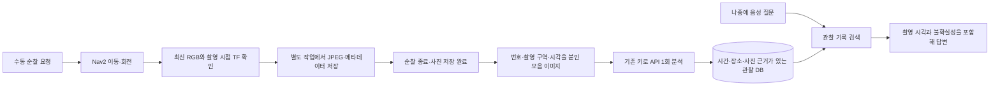
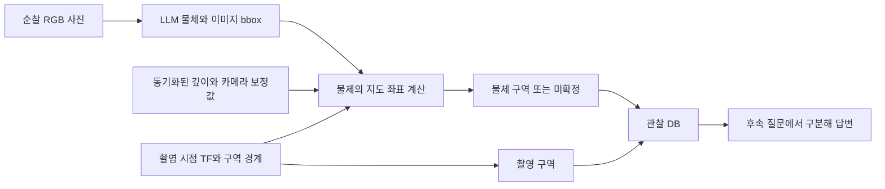

# Malbut Camera Patrol

저장된 지도에서 관측 위치를 자동으로 선택하여 접근 가능한 공간을
카메라로 살피는 단일 ROS Action입니다. 고정 순찰 좌표나 예약 주기는 없습니다.

수동 순찰은 기본적으로 서로 다른 카메라 시점의 사진을 기록합니다. 사진은
로컬에 저장하고, 순찰 종료 후 Agent 음성 서버가 기존 OpenAI 키로 묶어서 분석합니다.
이후 “아까 순찰 때 뭐 봤어?”, “리모컨 어디서 봤어?”처럼 물어볼 수 있습니다.
촬영·분석·조회 설정은 아래 **사진 관찰 기억**을 참고하세요.

## 공개 계약

- Action: `/patrol`, `malbut_interfaces/action/Patrol`
- Goal: `thoroughness` — `LIGHT=0`, `NORMAL=1`(기본), `THOROUGH=2`
- Feedback: `state`, `coverage_ratio`(0..1), `viewpoints_visited`
- Result: `success`, `message`, `coverage_ratio`, `viewpoints_visited`
- 모니터링 Topic: `/patrol/status`, `std_msgs/msg/String` JSON
  (`state`, `detail`, `coverage_ratio`, `viewpoints_visited`, `unvisited_rooms`,
  `inaccessible_rooms`, `room_count`: 이 순찰이 쓴 방 수, 방 파일이 없으면 0)
- 중앙 Manifest: `malbut_interfaces/capabilities/patrol.yaml`

한 요청은 한 번의 순찰입니다. 원하는 관측률과 접근 가능한 각 방의 방문·관측을
달성하면 성공합니다. 후보가 모두 막히거나 충분한 관측을 얻지 못하면 부분
관측률과 사유를 담아 실패로 종료합니다. 실패한 같은 후보를 무한 재시도하지
않습니다. 취소는 진행 중인 Nav2 Action의 종료 확인 후 완료합니다. 취소 확인이
늦어지면 경고와 `stopping` 상태를 유지하며, 해당 Nav2 목표가 실제 종료될 때까지
결과를 반환하거나 새 요청을 받지 않습니다. 중복 요청은 거부하며 선점 판단은
시스템 관리자가 담당합니다.

## 어떻게 위치를 고르는가

1. `/map`의 점유 격자에서 장애물 여유 거리와 로봇에서 연결된 안전 영역을
   한 번 계산합니다. 알 수 없는 영역과 벽은 통과하지 않습니다.
2. 안전 영역을 일정 간격으로 나누어 관측 후보를 만듭니다. 방 라벨이 있으면
   각 방에도 후보가 포함되게 합니다. 후보의 좌표는 모두 지도에서 계산합니다.
3. 각 후보에서 볼 수 있는 영역을 벽·미확인 영역의 가림과 거리로 계산해
   메모리에 보관합니다.
4. 방문하지 않은 방, 관측이 부족한 방, 새롭게 볼 수 있는 면적과 이동 거리를
   고려해 다음 후보를 고릅니다. 현재 Global Costmap에서 위험한 목표는 제외합니다.
5. Nav2 `NavigateToPose`로 이동하고 `Spin`으로 주변을 살핍니다. 이동·회전 중에도
   실제 RGB 프레임의 시각, CameraInfo의 수평 시야각, TF의 카메라 방향으로
   관측 영역을 갱신합니다. 새 목표를 보냈다는 이유로 관측률을 늘리지 않습니다.
6. 이미 본 면적을 제외하고 다음 후보를 선택합니다.

Nav2가 실제 경로·충돌 회피·회전을 담당합니다. 이 패키지는 속도 명령을
직접 발행하거나 Nav2 컨트롤러 설정을 바꾸지 않습니다.

## 꼼꼼함 기본값

| Goal | 관측 인정 거리 | 목표 관측률 | 후보 간격 |
|---|---:|---:|---:|
| LIGHT (0) | 4m | 80% | 1.5m |
| NORMAL (1) | 3m | 90% | 1.0m |
| THOROUGH (2) | 2m | 95% | 0.65m |

이는 초기 운용값이며 실측한 카메라 식별 성능을 뜻하지 않습니다. 강도가 높으면
가까이서 봐야 관측으로 인정하므로 더 많은 곳을 방문합니다. 전체 면적뿐 아니라
접근 가능한 각 방에도 목표 관측률을 적용합니다. 갈 수 없는 방은 완료 조건에서
제외하고 상태 정보로 구분합니다.

관측률은 **수평 시야를 평면 지도에 투영한 면적의 비율**입니다. 관측률 자체는 실제 영상
내용을 분석하거나 바닥·가구·벽의 모든 3D 표면이 보였는지 검사하는 지표가
아닙니다. 현재 LOS 가림은 저장 지도 기준이므로 움직이는 사람이나 높이가 다른
가구에 의한 추가 가림까지 완벽히 검증하지 않습니다. 분모는 안전한 후보에서
관측 가능한 알려진 자유 공간입니다.

## 실행

Nav2 Map Server에 현재 사용할 저장 지도를 로드하고, 위치 추정·카메라·Nav2를
먼저 실행합니다. `/map`을 사용하므로 패키지 안에 특정 지도 파일을 넣지 않습니다.
기존 Small House Nav2도 같은 입력을 제공합니다.

```bash
cd ~/ros2_ws
source /opt/ros/humble/setup.bash
colcon build --symlink-install --packages-select malbut_interfaces malbut_patrol
source install/local_setup.bash
ros2 launch malbut_patrol patrol.launch.py use_sim_time:=true \
  camera_optical_frame:=camera_depth_optical_frame
```

위 광학 프레임 지정은 Fortress RGB-D의 `camera_link` 헤더를 위한 것입니다.
실제 로봇은 `use_sim_time:=false`로 실행하고 표준 광학 프레임 헤더를 제공하면
`camera_optical_frame`을 비워둡니다. 방 라벨은 선택 사항이며
`room_map_file:=/absolute/path/to/user-map.geojson`으로 지정합니다. 좌표가 현재
`/map`과 일치하는 `role: room` Polygon/MultiPolygon을 사용합니다. 방 대표점을
고정 순찰 좌표로 사용하지 않습니다. 라벨이 없어도 전체 영역을 순찰합니다.

직접 실행:

```bash
ros2 action send_goal /patrol malbut_interfaces/action/Patrol \
  '{thoroughness: 1}' --feedback
```

시스템 관리자 경유 (`system_manager.launch.py`도 실행되어 있어야 함):

```bash
ros2 action send_goal /malbut/mission/execute \
  malbut_interfaces/action/ExecuteMission \
  "{capability_id: patrol, arguments_yaml: '{thoroughness: 1}'}" --feedback
```

새 Manifest는 `malbut_interfaces` 설치 폴더에 자동 포함됩니다. 이미 실행 중인
시스템 관리자는 재시작하여 목록을 다시 읽어야 합니다. 기능별 wrapper Action을
추가하거나 관리자 코드에 순찰 전용 분기를 넣지 않습니다.

기존 웹 순찰 시작·중지 API도 이 Action을 사용합니다. 예전 pause는 취소하여
IDLE로 돌아가고 resume은 새 순찰을 시작합니다. 순찰 이력을 보존하는 일시정지는
이번 Action 계약에 없습니다. 예전 `/patrol/start`, `/patrol/stop` 등의 Trigger와
`route_file` 기반 경로·예약 설정은 제거했습니다.

## 설정

ROS parameter로 환경과 운용값을 지정합니다.

| 파라미터 | 기본값 / 의미 |
|---|---|
| `map_topic` | `/map`, 저장된 `nav_msgs/OccupancyGrid` |
| `costmap_topic` | `/global_costmap/costmap`, 목표 안전성 확인 |
| `camera_image_topic` | `/camera/color/image_raw`, 실제 RGB 프레임 |
| `camera_info_topic` | `/camera/color/camera_info`, 광학 프레임·보정값 |
| `camera_optical_frame` | 빈 값: 영상 헤더 사용. Fortress는 `camera_depth_optical_frame` |
| `base_frame` | `base_footprint` |
| `room_map_file` | 빈 값, 선택적 방 라벨 GeoJSON |
| `nav2_action_name`, `spin_action_name` | `navigate_to_pose`, `spin` |
| `robot_clearance_m` | 0.26m, 후보 위치의 차체 외접 반경·여유 |
| `observation_ranges_m` | `[4.0, 3.0, 2.0]` |
| `coverage_targets` | `[0.80, 0.90, 0.95]` |
| `candidate_spacing_m` | `[1.5, 1.0, 0.65]` |
| `observation_hz` | 5Hz, 최신 프레임을 관측에 반영하는 최대 빈도 |
| `sensor_timeout_s`, `costmap_timeout_s` | 3s, 5s, 입력 단절 검출 |
| `navigation_timeout_s` | 120s, 한 후보에 묶이지 않도록 이동 취소 후 다른 후보 시도 |
| `stall_timeout_s`, `stall_distance_m` | 30s, 0.10m. Nav2가 재시도하는 동안 로봇이 이만큼 움직이지 않으면 이동 취소 후 다른 후보 시도 |
| `spin_time_allowance_s` | 60s, 한 바퀴 회전의 Nav2 실행 허용 시간 |
| `goal_response_timeout_s`, `cancel_completion_timeout_s` | 각각 5s, 통신 응답·종료 확인 |
| `maximum_goal_cost` | 80, OccupancyGrid 표현의 목표 허용 비용 |

실제 회전 속도는 기존 Nav2 Spin 설정을 따릅니다. 관측 계산은 요청 실행 중에만
수행하며, 대기 상태에서는 구독 메시지의 최신 값만 보관합니다. 새 저장 지도가
실행 도중 들어오면 남은 주행을 취소하고 새 지도에서 다시 요청하도록 알립니다.
Nav2가 전체 격자 대신 부분 갱신을 발행할 때는 `costmap_topic`에 `_updates`를
붙인 Topic의 `map_msgs/OccupancyGridUpdate`도 반영합니다.

## 사진 관찰 기억

### 분석 사진을 근거로 완료하는 순찰

`inspection_calibration_file`을 지정하면 보정된 **사진 분석 기반 순찰**을 사용한다.
빈 값이면 기존 4/3/2m 기하학적 관측과 순찰 종료 후 최대 24장 묶음 분석을 유지한다.
포함된 `config/inspection_sim_20261022.json`은 합성 장면에서 얻은 1m 존재 감지용
보정이며 **시뮬레이션 전용**이다. 종류 식별 검증이 아니고 실물 로봇에는 적용할 수 없다.
카메라 640×400, 수평 화각 약 74도, 높이 12cm, 모델 `gpt-5.6-luna`에 한정한다.
1m에서 존재 묘사는 11/12장, 종류 식별은 3/12장이었다. 1m 미만, 다른 조명과 물체,
3D 표면 전체 및 물체 위치 정확도를 보증하지 않는다.

- 시작점에서 먼저 360도 회전한다. 사진을 분석해 아직 확인하지 못한 면적과
  이동 거리를 고려하여 다음 위치를 선택하며, 목표는 전체와 각 방의 95%다.
  후보 간격은 기존 꼼꼼함 설정과 보정 거리의 절반 중 작은 값이다.
- 다른 방에서 보더라도 평면 가림을 통과한 분석 사진이 충분하면 방 진입은 요구하지 않는다.
  알려진 자유 공간 전체, 접근 가능한 후보의 관측 가능 면적, 제외 면적을 별도로 보고한다.
- 촬영은 최소 0.25초, 방향은 화각의 절반 간격, 가까운 위치 중복 기준은 0.25m다.
  이미 관측한 면적만 보이는 사진은 생략한다. 한 순찰의 수락 사진 상한은 160장이다.
- 이 모드의 사진은 묶음 표시 없이 저장되어 기존 Agent의 개별 사진 분석 경로에서
  순찰 중 처리한다. **사진마다 API 호출**이 발생하며 기존 분석 재시도 정책이 적용된다.
  기존 24장 모음 분석과 비용·지연이 다르다. Agent의 `MALBUT_PATROL_VISION_MODEL`은 보정 모델과 같아야 한다.
- 저장 완료와 DB의 `ready`만으로 성공하지 않는다. 현재 순찰·지도·환경·모델,
  촬영 메타데이터·사진·공간 근거 해시 및 카메라 보정을 확인한 사진만 관측으로 인정한다.
  완료 직전 이미 인정한 사진까지 다시 검증한다. 분석 결과는 종류 식별 보증이 아니다.
- 각 회전 후 수락한 사진의 저장·분석을 기다리며 계속 취소·센서 상태를 확인한다.
  `inspection_analysis_timeout_s`(기본 120초) 이내에 끝나지 않으면 실패한다.
  저장·분석 실패, 증거 불일치, 목표 미달 상태의 사진 상한 도달도 성공으로 처리하지 않는다.
  취소는 API 분석 종료를 기다리지 않고 기존 Nav2 취소 경계를 지킨다.
- 관측 지도와 근거 집합은 매 실행 새로 만든다. 이전 순찰의 분석을 면적으로 재사용하지 않는다.

시뮬레이션 Agent에는 `MALBUT_PATROL_SIMULATED=1`과 별도의
`MALBUT_PATROL_OBSERVATION_DIR`을 지정한다. 순찰에도 같은 디렉터리를 전달한다.
기존 실제 관찰 DB를 시뮬레이션 DB로 재사용하면 Agent가 거부한다.
Agent의 기존 키 연결을 사용하며 테스트를 위해 새 키를 만들거나 사진 폴더에 복사하지 않는다.

```bash
ros2 launch malbut_patrol patrol.launch.py use_sim_time:=true \
  observation_directory:=/absolute/path/to/simulation-observations \
  inspection_calibration_file:="$(ros2 pkg prefix malbut_patrol)/share/malbut_patrol/config/inspection_sim_20261022.json"
```

실제 Gazebo 카메라의 topic·광학 frame도 실행 환경에 맞게 지정해야 한다.
Bringup은 `patrol_inspection_calibration_file`과 `patrol_inspection_analysis_timeout_s`로
동일 설정을 전달한다. 실물 검증 보정은 별도로 필요하며 포함된 시뮬레이션 파일로 대체하지 않는다.
`/patrol/status`의 `coverage`는 분모와 방별 면적을, `evidence`는 분석 대기·실패·거부와
`recognition_validated=false`를 제공한다. 이후 절의 24장·1.5초·모음 분석 설명은
보정 파일을 지정하지 않은 기존 모드에 해당한다.



- 순찰 시작 시 첫 유효 시점을 기록하고 이후 `OBSERVING`에서 방향·위치가 달라진
  장면을 기록합니다. 촬영 간격은 최소 1.5초, 한 순찰 최대 24장입니다. 0.6m 안에서
  방향 차이가 60도보다 작은 시점은 중복으로 생략합니다. 이동 중에는 추가 촬영하지 않습니다.
- JPEG는 긴 변 최대 1280px입니다. 저장 큐는 4개로 제한하며 저장·API 요청은
  Nav2 실행 스레드를 막지 않습니다. 순찰 취소 전에 수락한 사진은 저장을 마칩니다.
- 기본 폴더는 `~/.local/share/malbut/patrol-observations`입니다. `captures/`에
  JPEG와 JSON, `observations.sqlite3`에 분석 결과·처리 상태를 저장합니다.
  JSON에는 순찰 ID, 사진 시각, 지도 해시, 카메라 위치·방향, 촬영 위치의 방 이름과
  사진 해시가 들어갑니다. 방 라벨이 없으면 방 이름을 만들어내지 않습니다.
- 사진 폴더의 한도는 512MiB입니다. 한도에 도달하면 기존 증거를 보존하고 새 사진
  저장을 실패로 기록합니다. `/patrol/status`의 `photos`에는 `queued`, `saved`,
  `failed`, `last_error`, `batch_ready`가 있습니다. 순찰 이동 성공과 사진 저장·분석 성공은 별개입니다.
- OpenAI 분석은 로봇의 음성 Agent가 시작할 때 함께 시작합니다. 단독 순찰만 실행해도
  사진은 저장하며, Agent를 켜면 종료된 미분석 순찰 묶음을 다시 읽습니다. 새 키를 만들거나 키를
  사진 폴더에 복사하지 않습니다. 웹에서 관리하는 키와 기존 환경 키의 우선순위를 유지합니다.
- 키가 없으면 사진을 보류하며 키 설정 후 재시도합니다. 그 외 분석 실패는 60초 간격으로
  순찰 묶음당 최대 3회 시도한 뒤 `failed`로 남깁니다. 오류를 관찰 내용으로 저장하지 않습니다.
- 관찰은 Agent의 설정된 `user_id`에 귀속됩니다. 다른 사용자로 같은 폴더를 열어
  이전 기록을 가져갈 수 없습니다. 사진 관찰 기록은 대화에서 추출하는 개인 취향·이름
  기억과 구분되며, 해당 개인화 동의 설정을 변경하지 않습니다.
- 원본 사진이 없어지거나 해시가 바뀐 기록, 미분석·실패 기록은 답변 근거로 쓰지 않습니다.
  `use_sim_time=true` 사진은 로컬에 남지만 실제 집의 관찰 기억으로 분석·조회하지 않습니다.

로컬 통합 시험에서는 별도 폴더에 `PatrolMemoryStore(directory, owner_id,
simulation=True)`를 명시해 가상 사진의 분석·재조회 경로를 검증할 수 있습니다.
DB에 환경 구분이 고정되어 실제 관찰 DB와 바꾸어 열 수 없으며, 검색 결과에도
`environment`, `simulated`, `analysis_model`을 남깁니다. 일반 Agent는 기본적으로 실제 관찰 DB를 사용하며, 시뮬레이션 분석은
`MALBUT_PATROL_SIMULATED=1`을 명시했을 때만 활성화됩니다. 외부 API 없이 분석 대역을
쓰는 시험은 해당 모델명을 명시하며 실제 AI 분석 결과와 구분해야 합니다.

순찰과 Agent 프로세스에 같은 환경을 전달합니다.

| 환경 변수 | 의미 |
|---|---|
| `MALBUT_PATROL_OBSERVATIONS` | 기본 `1`. `0`이면 자동 촬영·분석·조회 연결을 끕니다. 기존 파일은 보존합니다. |
| `MALBUT_PATROL_OBSERVATION_DIR` | 사진과 관찰 DB 폴더. 기본값은 위 경로입니다. |
| `MALBUT_PATROL_VISION_MODEL` | 선택 사항. 기본은 기존 Agent의 `openai_model`입니다. 이미지 입력을 지원해야 합니다. |

단독 `patrol.launch.py`에서는 `record_observations:=false`와
`observation_directory:=/절대/경로`도 지원합니다. 이 파라미터는 촬영 프로세스에만
적용되므로 분석·조회까지 끄려면 공통 환경 변수로 설정합니다.

음성에서는 조회 도구가 자동으로 제공됩니다. HTTP 대화 서버는 같은 `user_id`와
기존 관찰 폴더를 사용하면 `search_patrol_observations`를 사용할 수 있습니다.
요청의 `available_tools`에 이 이름을 포함합니다. 도구 인자는 `query`(짧은 물건·장소
키워드 또는 `null`), `since`/`until`(시간대가 있는 ISO 시각 또는 `null`), `limit`(1~5)입니다.
분석 중인 사진은 아직 답할 수 없다고 알리며, 관찰을 현재 상태로 단정하지 않습니다.
예: “오후 2시 순찰 사진에서 소파 위 리모컨을 봤어요.”

### 순찰 1회 → 모음 이미지 1장 → 분석 호출 1회

새 촬영 기록은 `analysis_batch=patrol_mosaic_v1`을 사용합니다. 순찰이 끝나고
수락한 모든 사진의 저장이 끝나면 `runs/<patrol_id>.json`에 사진 ID와 각 manifest의
해시를 원자적으로 기록합니다. 완료·부분 완료·취소된 순찰도 저장에 성공한 사진들을
하나의 묶음으로 분석합니다. 이동 및 취소는 디스크 저장이나 API 응답을 기다리지 않습니다.
프로세스가 강제 종료되면 다음 촬영 프로세스 시작 때 저장 완료된 사진만 모아
`interrupted` 묶음으로 복구합니다. 아직 진행 중인 순찰은 먼저 분석하지 않습니다.

- 최대 24장을 F01~F24로 번호 매겨 한 JPEG에 배치합니다. 종횡비를 유지하고
  카드 사이 16px 간격과 4px 색 테두리를 두고, 사진을 가리지 않는 제목 영역에
  큰 사진 번호·행/열·촬영 구역 코드·원본 촬영 시각을 붙입니다.
  C1/C2 같은 코드는 함께 전송하는 JSON 표에서 실제 구역 ID·이름과 연결됩니다.
  촬영 시각의 시간대는 같은 표의 `captured_at`에 포함됩니다.
- 사진 수에 따라 칸 크기를 640×480 / 480×360 / 320×224으로 조절합니다.
  24장 모음은 1392×1744이며 32px 패치 2,420개로, 현재 모델의 high 입력 예산
  2,500패치 안에 들어갑니다. 모음 JPEG는 최대 4MiB입니다.
- 요청에는 이미지 **1개**와 사진별 구역·시각·위치 표가 들어갑니다. 정상 성공 시
  순찰당 API **1회**이며, 오류 재시도는 추가 호출입니다. 서로 다른 순찰을 섞지 않습니다.
- 모델은 사진마다 요약·주요 물체 최대 8개·불확실성을 반환합니다. 전체 응답 한도는
  12,000토큰입니다. 누락·중복·알 수 없는 사진 번호가 있으면 부분 결과를 저장하지 않습니다.
- 각 칸의 픽셀 범위와 0~1000 정규화 범위(`photo_rect_1000`)를 함께 제공합니다.
  응답 스키마는 사진 ID를 내용보다 먼저 배치합니다. 물체 bbox는 모음 전체 좌표로 받고,
  서버가 해당 사진 칸의 원본 정규화 좌표로
  복원합니다. 다른 칸·제목 영역에 걸친 bbox는 물체 구역을 미확정으로 처리합니다.
  기존 원본 RGB-D·TF·구역 스냅샷을 사용하므로 촬영 구역과 물체 구역은 계속 구분됩니다.
- 분석 결과는 사진별 관찰 행으로 **한 DB 트랜잭션에서 함께 저장**합니다.
  원본 사진과 과거 관찰은 보존하며, 촬영 시각 기준 검색도 유지합니다.
- `batches/<patrol_id>.jpg`에 실제 입력 모음을 보관합니다. DB의
  `patrol_analysis_batches`에는 사진 목록·칸 배치·모음 해시·모델·성공한 응답의
  `input_tokens`, `output_tokens`, `total_tokens`, `cached_input_tokens`를 저장합니다.
  실패 응답과 후속 질문 비용은 이 성공 기록에 포함되지 않습니다.
- 이전 버전에서 이미 찍은 묶음 표시 없는 사진은 기존 개별 분석 경로로 계속 처리합니다.

한 번 호출한다고 이미지 토큰이 한 장의 고정 요금이 되는 것은 아닙니다.
반복 지시문을 줄이고 전체 이미지 크기를 제한해 입력 토큰을 절약하는 방식입니다.
24장을 작게 배치하면 작은 물체의 식별력이 떨어질 수 있으며, 원본 사진은 그대로 남깁니다.
칸 내부 좌표나 `ready` 상태가 의미 정확성을 보장하지 않습니다.

### 촬영 구역과 물체 구역

`capture_rooms`와 `capture_regions`는 촬영 당시 카메라의 지도 위치가 들어간
구역입니다. 물체의 위치는 각 `objects[].spatial`에 따로 저장합니다. 예를 들어
거실에서 문 너머 작업실의 상자를 찍으면 촬영 구역은 거실이고, 깊이 영상으로
확인한 상자의 구역은 작업실입니다. 카메라 구역을 물체 구역으로 복사하지 않습니다.



- 묶음 모델은 모음 전체 기준의 `sheet_bbox`를 제공합니다. 서버가 사진 칸의 위치와
  크기를 이용해 원본 기준 `[left, top, right, bottom]` 정규화 `image_bbox`로 복원합니다.
  이전 개별 분석은 원본 기준 `image_bbox`를 직접 받습니다. 서버가 중앙 영역의 깊이를
  검증하고 촬영 시점 optical→map 변환으로 `spatial.map_position`을 계산합니다.
  모델은 구역 ID나 지도 좌표를 정하지 않습니다.
- `spatial.status=located`일 때 `region.id/name`은 깊이에 근거한 **위치 추정**입니다.
  계산 좌표는 물체의 보이는 표면이며 물체 중심이나 전체 점유 영역을 뜻하지 않습니다.
  가림, bbox 오인식, 카메라 보정·자기 위치 오차의 영향을 받을 수 있습니다.
- 깊이 없음·RGB 미정합·시차 50ms 초과·보정값 불일치·혼합 깊이·구역 겹침·경계
  근처에서는 `status=unknown`, `region=null`, `reason`을 기록합니다.
  이전 v1 사진도 계속 읽지만 깊이가 없으므로 물체 구역을 소급 추정하지 않습니다.
- 새 v2 기록은 `captures/<id>.jpg`, `<id>.json`, `<id>.regions.json`과
  사용 가능한 경우 `<id>.depth.npy`를 보관합니다. NPY는 미터 단위 float32 깊이입니다.
  JSON에는 각 파일의 SHA-256, 촬영 시점 RGB·깊이 시각, 내참수, 전체 3D TF가 있습니다.
  구역 경계와 이름은 복사되어 이후 지도 편집에도 과거 관찰 기준을 보존합니다.
  어느 증거 파일이든 변조·삭제되면 그 관찰을 답변 근거에서 제외합니다.
- `depth_image_topic` 기본값은 `/camera/depth/image_raw`입니다. 단독 launch의
  `depth_aligned_to_rgb` 기본값은 `false`이며 RGB와 같은 픽셀 좌표로 정합된 깊이임을
  확인한 경우만 `true`로 켭니다. 크기와 헤더 frame도 RGB/CameraInfo와 같아야 하고
  현재 구현은 왜곡 보정된 pinhole 영상만 지원합니다. 32FC1(m), 16UC1(mm)을 받습니다.
  Gazebo RGB-D는 정합을 활성화합니다. 로봇 Bringup은 기존 RGB-D 정합 계약을 쓰는
  `patrol_depth_aligned_to_rgb`와 `depth_topic`을 전달합니다. 장비 보정·frame 검증에
  실패해도 RGB 관찰은 저장하며 물체 구역을 미확정으로 남깁니다.

예시 저장 필드:

```json
{
  "capture_regions": [{"id": "living", "name": "거실"}],
  "objects": [{
    "name": "붉은 직사각형 물체",
    "spatial": {
      "status": "located",
      "region": {"id": "workroom", "name": "작업실"},
      "map_position": {"x": 0.750, "y": 0.003, "z": 0.308},
      "method": "registered_rgbd",
      "reason": null
    }
  }]
}
```

이 예시의 `capture_regions`는 DB `metadata`, `objects`는 DB `analysis`에 저장되고,
조회 도구가 두 항목을 합쳐 전달합니다. 시간별 자동 순찰 예약은 이 기능에 포함하지 않습니다.

### 물체 이동 후의 관찰 이력

물체를 다시 보면 새 `observation_id`와 `patrol_id`, 촬영 시각으로 관찰을 추가합니다.
이전 사진·분석·구역을 덮어쓰지 않습니다. 조회는 **분석 완료 시각이 아닌 촬영 시각**
내림차순이므로 오래된 사진의 분석이 늦게 끝나도 최신 위치로 올라오지 않습니다.
현재 위치 질문에는 가장 최근 관련 관찰의 시각과 마지막 확인 위치를 우선 안내하고,
이전 위치는 과거 기록으로 구분합니다. `since`/`until`로 과거 시점만 조회할 수도 있습니다.

최신 관련 관찰의 물체 구역이 미확정이면 이전 확정 구역으로 대체하지 않습니다.
사진에 물체가 안 보였다는 이유만으로 이전 관찰을 삭제하거나 이동했다고 판단하지 않습니다.
조회 결과의 `ordering=captured_at_desc`, `object_identity=untracked_visual_descriptions`가
이 의미를 전달합니다. 현재는 영구 물체 ID로 재식별하는 시스템이 아니므로, 모양·색이
비슷한 물체가 여러 개일 때 같은 물체의 이동이라고 확정할 수 없습니다. 위치 변화 질문은
과거 구역명으로 제한하지 않고 물체 키워드 또는 최근 전체 관찰을 조회해 비교합니다.

대화 조회는 문자 일치 기록에 최근 관찰 후보도 포함합니다. 예를 들어 “붉은 직사각형
물체”와 “빨간색 직육면체”처럼 분석 표현이 바뀌어도 비교할 수 있습니다. 문자 일치하지
않은 항목에는 `match_kind=recent_context`를 붙이며, 모델은 질문과 색·형태·설명이
부합하는지 확인해야 합니다. 시간 범위·소유자 제한과 증거 검증은 후보에도 동일하게
적용합니다. 최대 반환 개수와 4,000자 제한이 있어 전체 물체 이력을 보장하는 검색은 아닙니다.
