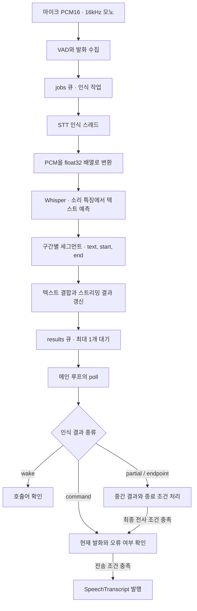
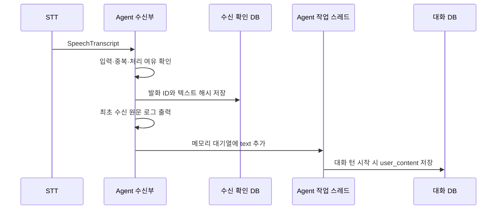

# STT 인식 결과와 “구독과 좋아요” 문구 조사

조사일: 2026-10-11. 기준 커밋: `5a50ace` (PR #237 머지 직후 `main`).
원본 `malbut_stt`와 실기기 적용본 `malbut_test/malbut_stt`를 확인했다.
이 문서는 조사 기록이며, 런타임 코드나 인식 필터를 변경하지 않는다.

## 확인한 내용

- 기준 커밋의 `malbut_test`에는 “구독과 좋아요”라는 고정 문구가 없다.
- 원본 `malbut_stt/test/test_diagnostics.py`에는 `구독과 좋아요!`를 반환하는
  **가짜 모델 결과**가 있다. 실제 음성 인식 기록이나 런타임 입력 프롬프트가 아니다.
- 현재 발화의 최종 결과로 이 문구가 들어오면 STT는 전송 콜백으로 전달할 수 있다.
  빈 결과·예외·오래된 발화는 검사하지만 이 문구를 차단하는 별도 검사는 없다.
- 실제 녹음에서 같은 문구가 나온 원인은 이번 조사로 확정하지 않았다.
  마이크·실제 Whisper 모델·ROS 통신·TTS를 함께 실행한 재현은 하지 않았다.

## 세그먼트와 텍스트

Whisper의 세그먼트는 구간별 인식 결과다. 한 세그먼트가 반드시 한 문장이나
한 단어와 일치하지는 않는다. 기본 정보는 다음과 같다.

| 필드 | 의미 |
|---|---|
| `text` | 해당 구간에서 인식한 텍스트 |
| `start` | 인식기에 넣은 오디오 안에서 추정한 시작 시각(초) |
| `end` | 추정한 종료 시각(초) |

`incremental.py`는 잘라 넣은 오디오의 시작 위치를 더해 발화 내 시각으로 변환한다.
`cpp_transcription.py`는 C++ 결과를 UTF-8로 읽고 `text`, `start`, `end`를 가진
Python 객체로 복사한다. 원시 타임스탬프의 1/100초 단위도 초로 변환한다.

문제가 된 테스트 데이터는 다음과 같다.

```python
segment = SimpleNamespace(
    text='  구독과 좋아요! ',
    start=0.1,
    end=2.0,
    no_speech_prob=0.91,
    avg_logprob=-1.2,
)
```

이 값들은 테스트 작성자가 넣은 값이다. `Model([segment])`가 결과를 돌려주면
진단 래퍼가 원문·부가 필드·PCM을 바꾸지 않고 기록하는지 검사한다.
품질 관련 수치도 가상 값이며, 배포 C++ 어댑터의 반환 필드에는 이 두 수치가 없다.
진단 기록 기능 자체는 결과를 판정하거나 걸러내지 않는다.

기준 코드: [진단 테스트](https://github.com/SWM-malbut/malbut/blob/5a50ace/malbut_stt/test/test_diagnostics.py#L38),
[C++ 결과 어댑터](../malbut_stt/cpp_transcription.py),
[스트리밍 결과 처리](../malbut_stt/incremental.py).

## Whisper에서 results 큐까지

Jetson 설정은 `whisper_cpp`를 선택한다. 로컬 모델을 불러와 재사용하며,
일반 전사의 언어는 한국어, 디코딩은 greedy이고 `temperature=0`이다.
호출어 인식은 같은 모델에 `로봇 이름은 제이크입니다.`라는 힌트를 주며,
일반 스트리밍 전사에는 `initial_prompt=None`을 전달한다.
모델 크기와 파일은 실행 시 지정하는 `stt_model_path`에 따라 달라진다.



Whisper 내부에서는 소리의 주파수 특징을 인코더가 분석하고, 디코더가 음성 특징과
이미 생성한 토큰을 참고해 다음 토큰을 예측한다. 토큰들을 문자로 복원한 것이
세그먼트의 텍스트다. 프로젝트의 C++ 연결부에서는 `whisper_full()`이 이 작업을
실행한다. 인식한 문장을 `.txt` 파일로 저장한 뒤 읽어오는 구조는 아니다.

구조 참고: [Whisper 모델](https://github.com/openai/whisper/blob/main/whisper/model.py),
[Whisper 디코딩](https://github.com/openai/whisper/blob/main/whisper/decoding.py).

`DialoguePipeline`의 세 큐는 같은 STT 프로세스의 RAM에 있다.

| 큐 | 대기 항목 수 제한 | 내용 |
|---|---:|---|
| `audio` | 64 | 마이크 오디오와 수집 시점 정보 |
| `jobs` | 1 | 인식 작업 종류·세대·발화 식별자·오디오 입력 |
| `results` | 1 | 아래 여섯 값을 묶은 인식 결과 |

```python
result = (kind, generation, uid, text, error_name, retained_start_s)
self.results.put(result, timeout=0.05)
```

- `kind`: `wake`, `command`, `partial`, `endpoint` 중 작업 종류.
- `generation`: 취소·초기화 이전의 결과를 구분하는 세대 번호.
- `uid`: 발화 ID. 중간 인식 작업에서는 `(발화 ID, revision)` 튜플.
- `text`: 인식한 문자열. 인식 실패 시 `None`일 수 있다.
- `error_name`: 성공 시 `None`, 실패 시 예외 종류.
- `retained_start_s`: 스트리밍에서 남겨 둘 오디오 구간의 시작 시각.

큐에는 Python 객체의 참조가 들어간다. `maxsize=1`은 대기 항목 수 제한이며
텍스트 길이 제한이 아니다. 큐가 차 있으면 인식 스레드는 최대 50ms 기다리고,
계속 차 있으면 종료 요청이 없는 동안 다시 시도한다.
`poll()`의 `get_nowait()`는 항목을 큐에서 꺼내 지역 변수로 넘긴다.
중간 결과는 후처리 상태에 남을 수 있으므로, 큐에서 꺼낸 시점에 모든 텍스트가
메모리에서 즉시 삭제되는 것은 아니다.

코드: [인식 스레드와 큐](../malbut_stt/dialogue_pipeline.py),
[PCM 변환과 기본 전사](../malbut_stt/transcription.py).

## Agent 전달과 저장

STT는 `SpeechTranscript(utterance_id, text, session_id)`를
`/malbut/speech/transcript`로 발행한다. 일반 발화의 `session_id`는 빈 문자열이며,
Agent가 연 확인 세션에는 해당 세션 ID를 넣는다. 중간 인식 결과는 이 Topic으로
보내지 않는다. 아래 저장 흐름은 일반 발화 기준이다.



| 위치 | 내용 |
|---|---|
| STT `results`와 Agent `_pending` | 처리 전 텍스트를 메모리에 보관 |
| `~/.local/state/malbut/speech-receipts.sqlite3` | `speech_receipts`에 발화 ID, SHA-256, 수신 시각. 원문은 저장하지 않음 |
| `~/.local/state/malbut/speech-dialogue.sqlite3` | `conversation_turns.user_content`에 발화, `assistant_content`에 답변 |
| ROS 수신 로그 | 최초 접수 시 `text` 원문 출력. 파일 기록 위치는 실행 환경에 따름 |
| `MALBUT_STT_DIAGNOSTIC_DIR` | 설정한 경우 모델 입력 WAV, 구간별 결과 JSON, 파이프라인 이벤트 기록 |

`~`는 실행 계정의 홈이다. 대화 DB는 `--conversation-db`로 변경할 수 있다.
수신 DB에 기록됐다는 사실만으로 대화 처리 완료가 보장되지는 않는다.
그 뒤의 메모리 대기열 등록이나 대화 처리 전에 실패하면 대화 원문이 대화 DB에
없을 수 있다. Topic QoS는 `RELIABLE`, `VOLATILE`, depth 10이며, STT에는
애플리케이션 수준의 접수 ACK와 자동 재전송이 없다.

코드: [STT 발행](../malbut_stt/node.py),
[Agent 수신](../../malbut_agent_server/malbut_agent_server/ros_communication.py),
[수신 DB](../../malbut_agent_server/malbut_agent_server/speech_receipts.py),
[Agent 대기열](../../malbut_agent_server/malbut_agent_server/speech_dialogue.py),
[대화 저장](../../malbut_agent_server/malbut_agent_server/conversation.py).

## 문구 통과 재현

기준 커밋의 검색 결과는 원본 진단 테스트 한 곳이다. 이 조사 문서에 추가한
문구와 구분하려면 검색할 커밋을 지정한다. 명령은 원본 저장소 루트에서 실행한다.

```bash
git grep -n -F '구독과 좋아요' 5a50ace -- malbut_test malbut_stt
```

다음 재현은 실기기 적용본 모듈을 불러온 뒤, 활성화한 일반 발화의 결과 큐에
가상 최종 전사를 넣는다. 마이크·VAD·Whisper 추론을 거치지 않으며,
전송 콜백을 수집하므로 실제 ROS 메시지도 발행하지 않는다.

```bash
PYTHONPATH=malbut_test/malbut_stt python3 - <<'PY'
from types import SimpleNamespace
from malbut_stt.dialogue_pipeline import DialoguePipeline
from malbut_stt.endpoint import is_complete_korean_utterance

for text in (
    '구독과 좋아요!',
    '구독과 좋아요 부탁드립니다.',
    '시청해 주셔서 감사합니다.',
):
    published = []
    pipeline = DialoguePipeline(
        recorder_factory=lambda: None,
        wake=SimpleNamespace(), transcriber=SimpleNamespace(),
        is_speech=lambda *args: False,
        publish_transcript=lambda uid, value: published.append(value),
        publish_control=lambda *args: None,
        publish_interruption=lambda *args: None,
        report=lambda *args: None,
    )
    pipeline.session.activate()
    uid = pipeline.session.user_speech_started()
    pipeline.results.put(('command', pipeline._generation, uid, text, None, 0.0))
    pipeline.poll()
    assert published == [text]
    assert pipeline.results.empty()
    print(text, published, is_complete_korean_utterance(text))
PY
```

| 가상 최종 결과 | 전송 콜백 | 문장 종료 어미 힌트 |
|---|---|---|
| `구독과 좋아요!` | 원문 그대로 전달 | `True` |
| `구독과 좋아요 부탁드립니다.` | 원문 그대로 전달 | `False` |
| `시청해 주셔서 감사합니다.` | 원문 그대로 전달 | `False` |

어미 힌트는 1초 무음 뒤 조기 종료를 판단할 때 사용하는 보조 조건이다.
`False`여도 최종 전사를 거부하지 않으며, `True`만으로 즉시 전송하지도 않는다.
`구독과 좋아요!`의 경우 `좋아요` 어미가 힌트에 맞는다. 세 문구 모두 호출어
`제이크` 또는 `제이크야`에는 해당하지 않는다.

관련 진단 테스트도 배포 모듈을 대상으로 실행했다.

```bash
PYTHONPATH=malbut_test/malbut_stt python3 -m pytest -q malbut_stt/test/test_diagnostics.py
```

결과: 11개 통과. 원본 저장소의 테스트를 사용하며, `malbut_test`에는 STT 테스트를
복제하지 않는다. 이 재현과 테스트는 인식 결과의 보존·전달을 검증한다.
실제 소음에서 특정 문구가 생성되는 빈도나 Whisper의 인식 정확도를 검증하지 않는다.

## 남은 확인

현재 코드는 비어 있지 않은 전사의 의미가 실제 음성과 맞는지 별도로 판정하지
않는다. 기존 [STT 예외 처리 명세](stt_agent.md#4-예외-처리)에도 이 한계가 적혀 있다.
문구가 실제로 발생한 원인을 확인하려면 같은 발화 ID와 추론 세대에 연결된
모델 입력 WAV, 원시 세그먼트, `inference_result` 이벤트를 함께 확인해야 한다.
진단 설정과 저장 한도는 [STT 재현 기록](../README.md#stt-재현-기록-기본-off)을 따른다.
